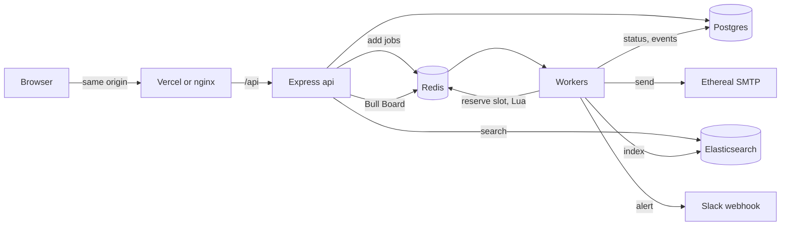
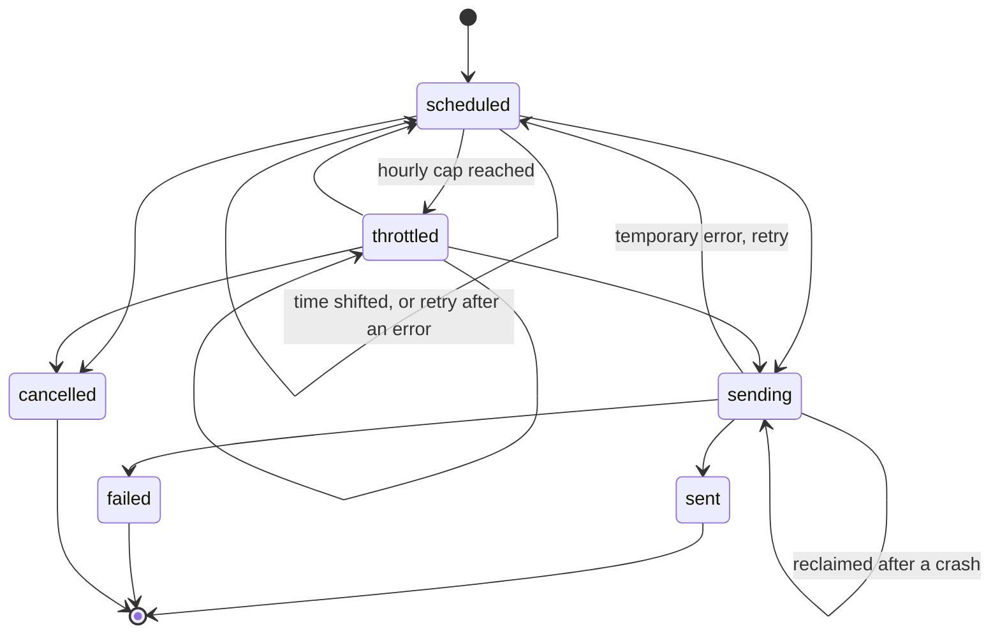
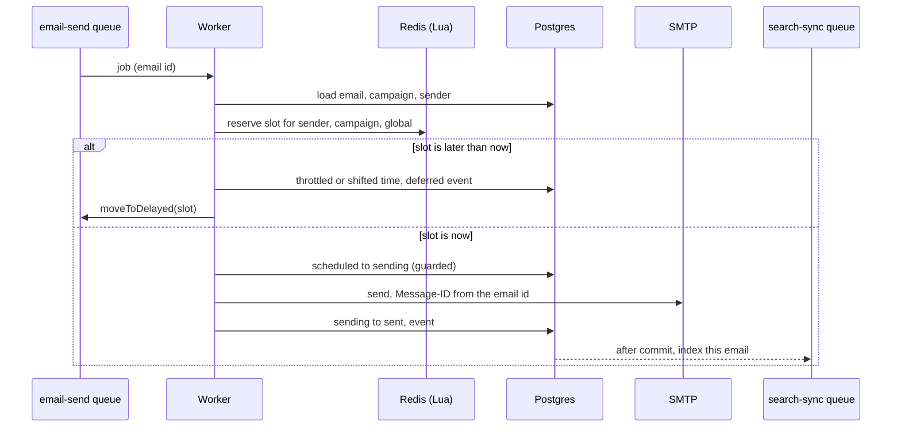
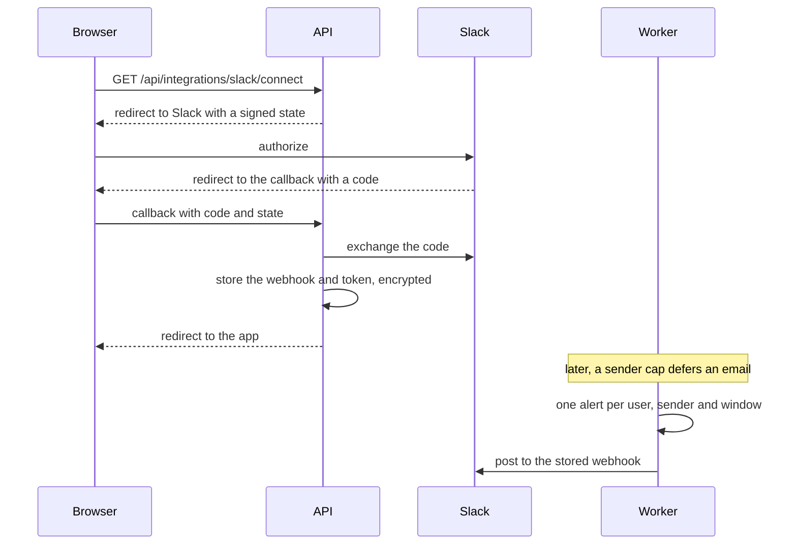

# Architecture

## Components

The api and the worker are the same image started with a different `ROLE`. The api takes requests and adds jobs. The worker runs three BullMQ workers: `email-send`, `search-sync` and `notifications`. Postgres holds the truth, Redis holds the queue and the rate-limit counters, and both Elasticsearch and Slack are optional extras that sending never waits for.

## Email lifecycle

Every status change goes through one function, `modules/emails/transition.ts`. It runs `UPDATE ... WHERE id = $1 AND status = ANY($from)`, writes the event row in the same transaction and, after the commit, queues a search-sync job. It returns nothing when another process already moved the row, and the caller treats that as a no-op.

## Send path

The reservation comes before the claim. A job that has to wait never touches the row's `sending` state. When a deferred job wakes, the reserved time is already in its data, so it does not reserve a second slot.

## Rate limiter

One Lua script, `queue/rate-limit/reserve-slot.ts`, decides when an email may go out. Redis runs a script atomically, so any number of workers can call it at once and no two get the same capacity.

For each bucket (the sender, the campaign and, if set, a global one) there are two kinds of key:

- `rl:sender:<id>:w:<window>` counts how many slots are taken in a fixed window. Windows are aligned to the clock, so with the default one hour they are UTC hours.
- `rl:sender:<id>:cursor` holds the earliest time the next send may start, which is what produces the gap between sends.

The script starts at the current time. If any bucket is full for that time's window, it moves to the start of the next window. If any cursor is later, it moves to that cursor. It repeats both checks until neither moves the time, then increments the counter of the window it landed in and advances each cursor by the bucket's interval.

A worked example: a sender capped at 3 per hour with a 2-second gap, and six emails reserved at 10:40:00.

| Email | Slot     | Why                                                      |
| ----- | -------- | -------------------------------------------------------- |
| 1     | 10:40:00 | free                                                     |
| 2     | 10:40:02 | the cursor moved 2 s                                     |
| 3     | 10:40:04 | the cursor moved 2 s                                     |
| 4     | 11:00:00 | the 10:00 window holds 3, so it moves to the next window |
| 5     | 11:00:02 | next window again, then the cursor                       |
| 6     | 11:00:04 | same                                                     |

Emails 4 to 6 come back with the reason `hourly`. The worker marks them `throttled`, records which bucket held them in `throttled_by`, writes a `deferred` event with the new time and moves each job to that time. They are not dropped and they stay in order. A push that comes only from a gap (`pacing`) just shifts `scheduled_at`, with no event.

The counter for a future window is incremented at reservation time. That is what keeps the next hour's slots from being handed out twice when a thousand jobs arrive at once.

## Persistence and failures

| What dies                        | What happens                                                                                                                                                                                          |
| -------------------------------- | ----------------------------------------------------------------------------------------------------------------------------------------------------------------------------------------------------- |
| API process                      | New scheduling requests fail. Queued emails keep sending, because the worker is a separate process.                                                                                                   |
| Worker, graceful stop            | Active sends finish. The rest wait in Redis and continue when a worker starts.                                                                                                                        |
| Worker, killed mid-send          | The job stalls and is retried after its 30 s lock expires. The `sending` row is reclaimed. A duplicate is only possible if SMTP had already accepted the message, and it carries the same Message-ID. |
| Redis restart                    | The append-only file restores delayed jobs and counters, with up to about a second of writes lost.                                                                                                    |
| Redis wiped                      | The reconciler rebuilds the jobs from Postgres on the next worker start. Counters start from zero, so one window's cap could be exceeded once.                                                        |
| Postgres down                    | Jobs fail and retry with backoff. Nothing is marked sent without the database.                                                                                                                        |
| Elasticsearch down               | Sending is unaffected. Sync jobs retry, and search falls back to Postgres.                                                                                                                            |
| Slack down, or the token revoked | The notification retries, or the connection is dropped. Sending is unaffected.                                                                                                                        |

On shutdown the api stops accepting requests, each worker finishes its active jobs, and then the queues, Redis connections and the Postgres pool close. The process exits after 25 seconds if something hangs, and compose gives each container 30 seconds.

The reconciler (`queue/reconcile.ts`) runs when a worker starts, and on demand with `npm run reconcile -w apps/server`. It takes a Redis lock so only one of several booting workers does the work, then pages through emails that are `scheduled`, `throttled` or `sending`, 1000 at a time. For each one it looks up the job by id and re-adds it, with the same id and the remaining delay, if the job is missing or already completed or failed. It writes a `requeued` event for each. It does not run on a timer, which would be a cron by another name.

## Idempotency

1. The job id is the email id, so adding the same email twice is a no-op in BullMQ.
2. A job can only send if it moves the row into `sending`. Sent, failed and cancelled rows are skipped.
3. The Message-ID is derived from the email id. If the process dies between the SMTP acceptance and my database update, the repeat carries the same Message-ID and can be deduplicated downstream.

The window that remains is the few milliseconds between the server accepting the message and my update committing. Inside it I chose at-least-once over at-most-once. The alternative is to mark such rows `unknown` and never resend them.

## Search

Emails are indexed into the alias `emails`, which points at a physical index named `emails-<timestamp>`. The mapping gives `recipient` an extra field analysed as an email address, so a prefix of an address matches, and keeps `subject` and `bodyText` as plain text.

The sync worker loads rows from Postgres by id, so a document always reflects the current row however many sync jobs are queued, and indexes them with the email id as the document id. Re-indexing an id is an upsert, so retries and repeats are safe.

A query is a `bool_prefix` match across recipient, subject and body, filtered by user and by the statuses of the tab. Elasticsearch decides which emails match and in what order. The api then loads those rows from Postgres, so a status that changed a moment ago is never shown stale, and attaches the highlights. The highlights come back HTML-encoded with `<mark>` tags, and the web app renders only those tags and treats everything else as text. If Elasticsearch fails or takes more than two seconds, the api answers from Postgres with `ILIKE` on recipient and subject and flags the response so the dashboard can say so.

## Slack

The state is a short-lived signed token that carries the user id, so the callback works without a session cookie. It has its own audience, and the session check refuses any token that has one, because the state travels through URLs. The webhook is read from Postgres when the alert is sent, so connecting or disconnecting takes effect immediately. A user with no connection simply gets no alert.

## At 100 times the volume

- The limiter script touches keys for one bucket per call. On Redis Cluster all keys in a script must share a slot, so I would put a hash tag in the key names and keep the global bucket on one node.
- The reconciler looks up one job per pending row. At millions of rows I would compare the ids in the delayed set against Postgres in bulk instead.
- One `email-send` queue is fine while delayed jobs sit in Redis. With many busy senders I would split it per sender group, so a long backlog on one sender does not share a worker pool with the rest.
- The `emails` table would be partitioned by month, so list queries and the reconciler touch only recent partitions.
- Elasticsearch sync would move to larger bulk batches, or to change data capture from Postgres, so a campaign of a million does not enqueue a million small jobs.

## Decisions

**Delayed jobs, not cron.** Context: emails must go out at exact times and survive restarts, and a polling loop wastes work and drifts. Decision: each email becomes a BullMQ delayed job with its time as the delay, persisted in Redis. Consequences: nothing polls, and the cost is a reconciler for the rare case where Redis loses jobs that Postgres still knows about.

**A slot-reservation limiter.** Context: BullMQ's built-in limiter slows a queue down but cannot say when a particular job may run, and it cannot express a cap per sender and per campaign together. Decision: reserve a time slot in Redis with one atomic script before every send, and delay the job to the slot. Consequences: limits hold across workers and deferred emails keep their order, but the counters live in Redis, so a wipe resets them.

**Postgres is the source of truth.** Context: Redis is fast and can lose data; the dashboard and the guarantees need a durable record. Decision: every email, status change and event is written to Postgres first, and the queue is a copy that can be rebuilt. Consequences: a Redis loss is recoverable and status changes are guarded by the database, at the price of a write per transition.

**The API is served from the frontend's origin.** Context: the session is a cookie, and cross-site cookies need CORS rules, `SameSite=None` and third-party cookie support. Decision: nginx locally and a Vercel rewrite in production forward `/api` to the backend, so the browser only sees one origin. Consequences: the cookie stays first-party and the app needs no CORS setup, and `APP_URL` has to be the frontend's address everywhere.
